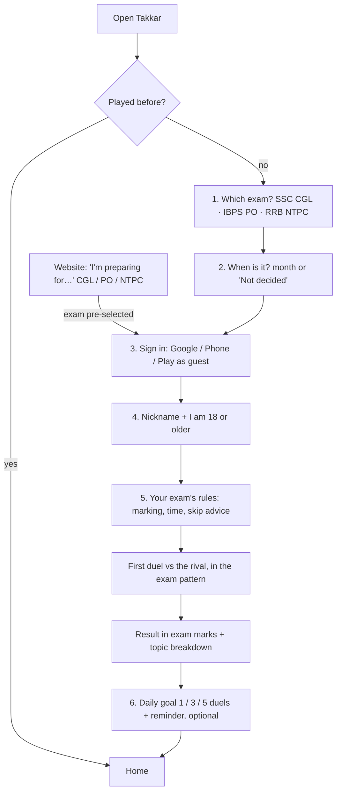
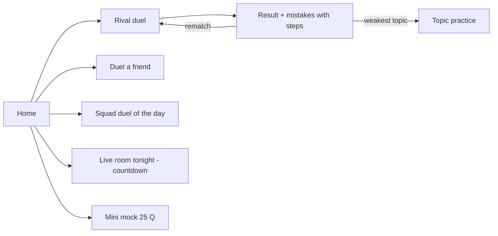
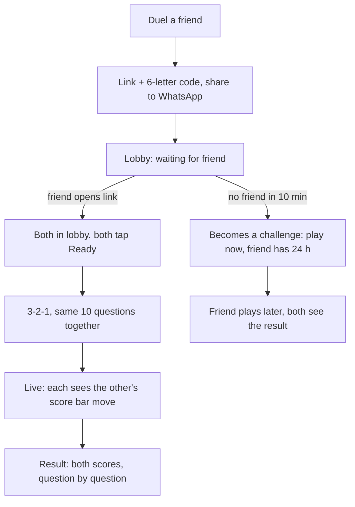
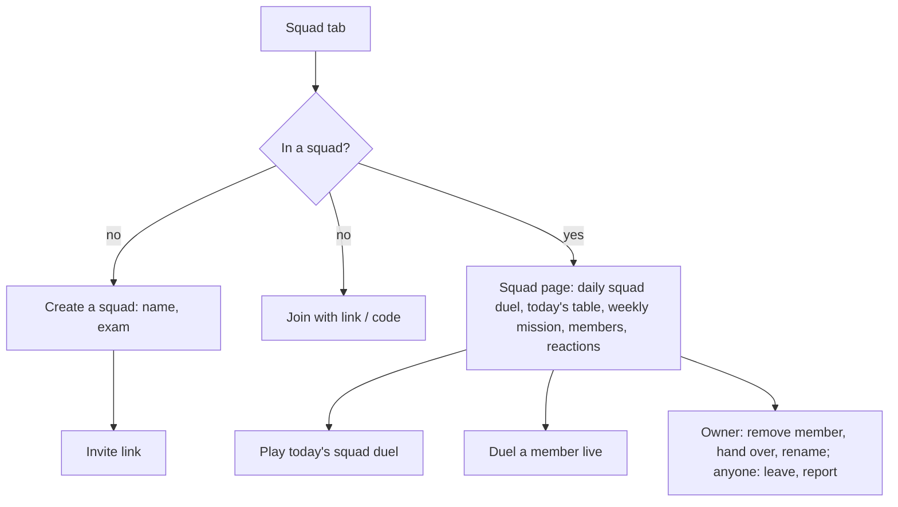
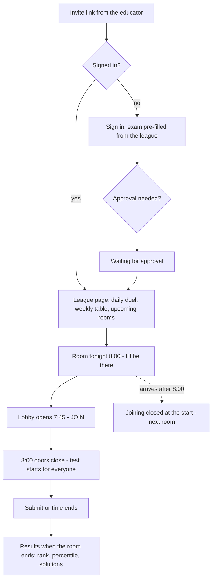
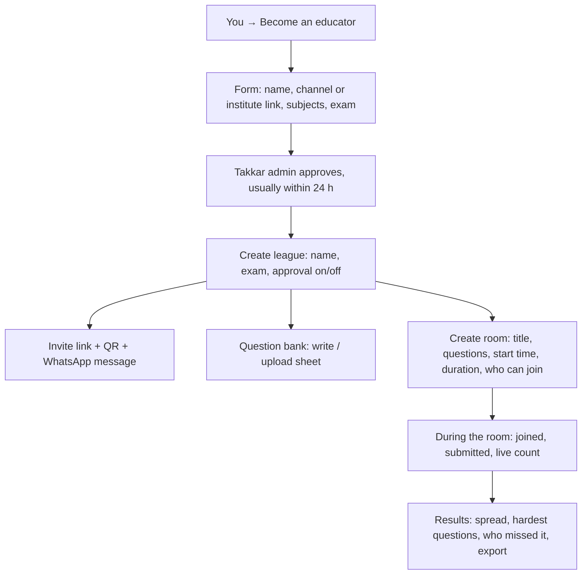

# 2. User flows

Diagrams use Mermaid (GitHub and VS Code with a Mermaid preview draw them).

## 2.1 New player: onboarding (about 60 seconds)

- The exam comes **first**, so the app feels like it is about *their* exam from the first tap. Sign-in comes after, with the exam already chosen.
- Coming from the website's exam picker skips step 1.
- Players from 0.2 (no exam yet) see step 1 once on their next open; their games are kept.
- Step 5 fixes today's surprise negative scores.

## 2.2 Daily loop

## 2.3 Friend duel

## 2.4 Squad

## 2.5 League and live room: student

## 2.6 Educator

## 2.7 Edge cases

- **Late for a room:** cannot join after the start; shown the next room. Educator can set a short grace period (0–5 min, default 0).
- **Disconnected in a room:** can rejoin if they joined before the start; the clock keeps running.
- **Friend leaves a live duel:** counts as a loss for them; the other finishes alone and wins if ahead.
- **Two people tap the same duel link:** the first to join plays; the second sees "This duel already has two players".
- **Room ends while someone is mid-question:** that question counts as skipped.
- **Educator removes a wrong question after the room:** everyone re-scored, ranks updated, with a note.
- **Guest tries to join a squad, league, room or friend duel:** must sign in (needs a stable identity). Rival duels and practice stay open to guests.
- **Under 18 opens an invite:** the age rule is shown; joining requires the 18+ confirmation.
