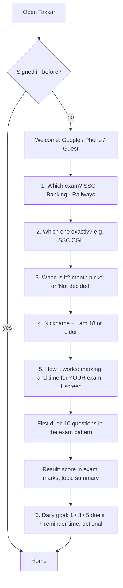
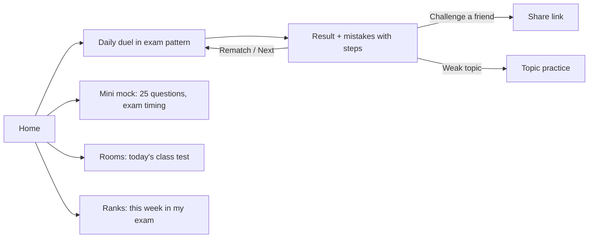
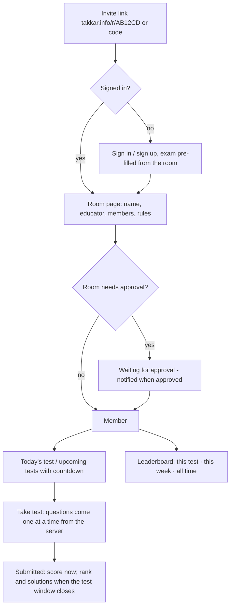
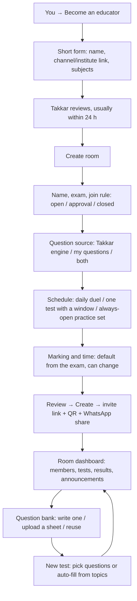

# 2. User flows

Diagrams use Mermaid; GitHub and VS Code (with a Mermaid preview) draw them.

## 2.1 New player: onboarding (about 60 seconds)

The goal: a first duel **in their exam's pattern** within a minute, asking only what changes the experience.

Notes
- Steps 1–3 come **before** sign-up questions, so the app already feels personal. Exam and date are stored on the phone for guests and on the account for signed-in players.
- Step 3 drives a **countdown** on Home ("68 days to SSC CGL Tier 1") and later a study plan. It is optional.
- Step 5 replaces the current jump straight into a duel: one screen that says "SSC CGL: +2 for right, −0.5 for wrong, 36 seconds a question. Skip if unsure." Players were getting −1s without knowing why.
- Step 6 comes **after** the first duel, when they have a reason to say yes.
- Changing the exam later: You → Exam. Ranks and room results are kept per exam.

## 2.2 Daily loop

## 2.3 Practice modes (new)

| Mode | What | Counts for ranks | Free |
| --- | --- | --- | --- |
| **Daily duel** | 10 questions, exam pattern, vs a bot rival | Yes (best 3 a day, as now) | 3 a day |
| **Topic practice** | Pick a topic (e.g. Time and work), 10 questions, no rival, timer optional, steps after each | No | Unlimited |
| **Mini mock** | 25 questions, Quant + Reasoning, exam timing and sectional time for banking, full analysis | Separate "mock rank" | 1 a day (Plus: unlimited) |
| **Challenge** | A friend's exact questions, beat their score | No | Yes |
| **Room test** | The educator's test (see rooms) | Room leaderboard | Yes |

## 2.4 Rooms: student

## 2.5 Rooms: educator

## 2.6 Edge cases the flows must handle

- **Invite link opened by someone under 18 or not signed in:** the room page shows the age rule; joining needs an account and the 18+ confirmation.
- **Room closed or educator removed:** members see "This room has closed" and keep their own past results.
- **Test window passes while a student is mid-test:** answers already given count; the rest are skipped; the server is the clock.
- **Phone goes offline mid-test:** the test is server-timed; on reconnect the remaining time is shown; answers queued offline are sent with their timestamps and accepted if within the window.
- **Educator edits a question after students answered:** the edit applies to future tests only; past results keep the version they saw.
- **Wrong question reported by a student:** goes to the educator first; if the educator agrees, the question is removed from scoring for everyone (re-scored automatically).
- **Guest tries to join a room:** must sign in (rooms need a stable identity for the leaderboard).
